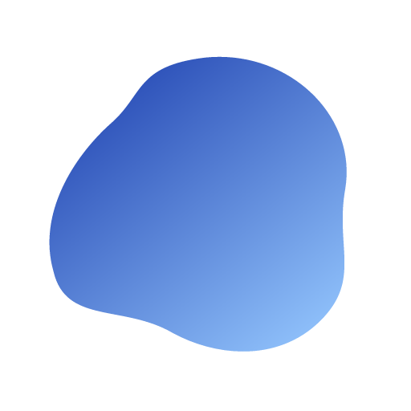

# NOVX Mirror

<div align="center">
  
  
  ### Récepteur AirPlay Haute Performance pour Windows

  Diffusez et enregistrez l'écran de votre iPhone ou iPad sur Windows en toute fluidité avec une expérience bureau native optimisée.

  [](LICENSE)
  [](https://github.com/Cori-bot/NovxMirror/releases)
  [](https://github.com/Cori-bot/NovxMirror/releases)
  [](https://github.com/Cori-bot/NovxMirror/actions/workflows/release.yml)
</div>

---

## 🌟 Points Forts

- 📱 **Compatibilité AirPlay Complète** — Mise en miroir fluide depuis n'importe quel iPhone ou iPad (iOS 12+).
- 🎨 **Interface Moderne & Épurée** — UI soignée sous Electron / React avec thèmes Clair, Sombre et Minuit.
- 🎙️ **Enregistrement Vidéo & Audio Natif** — Capture directe au format MP4 (H.264 + AAC) sans perte avec mixage audio Windows Loopback (WASAPI).
- 🔒 **Sécurisé & Personnalisable** — Protection par code PIN à 4 chiffres, choix du nom d'affichage AirPlay, résolutions et fréquence jusqu'à 60 FPS.
- 📐 **Format Dynamique & Respect du Ratio** — Passage automatique portrait/paysage sans déformation, avec ratio verrouillé et taille minimale sécurisée.
- ⌨️ **Ergonomie & Accessibilité** — Navigation au clavier complète (`:focus-visible`), fermeture instantanée des modales par la touche Échap, zoom accidentel neutralisé.
- 🌍 **Multilingue** — Disponible en Français, Anglais et Allemand.

---

## 📥 Téléchargement & Installation

Téléchargez la dernière version prête à l'emploi depuis les **[Releases GitHub](https://github.com/Cori-bot/NovxMirror/releases)** :

1. Téléchargez **`Novx-setup.exe`**.
2. Lancez l'installateur (un raccourci sur le Bureau et dans le menu Démarrer sera créé).
3. Assurez-vous que le service **Apple Bonjour** est présent (l'application détecte automatiquement son statut et propose son installation guidée si nécessaire).
4. Connectez votre iPhone/iPad au même réseau Wi-Fi, ouvrez le *Centre de contrôle*, touchez *Recopie de l'écran* et sélectionnez votre récepteur **NOVX Mirror**.

---

## 🛠️ Architecture & Fonctionnement

NOVX Mirror combine la puissance d'un moteur C/C++ natif et la réactivité d'Electron :

```
┌─────────────────────────────────────────────────────────────┐
│                      iPhone / iPad                          │
│                (Recopie d'écran AirPlay)                    │
└──────────────────────────────┬──────────────────────────────┘
                               │
                      1. Découverte Bonjour
                               │ (mDNS / Zeroconf)
                               ↓
┌─────────────────────────────────────────────────────────────┐
│              NOVX Mirror (Application Windows)              │
├─────────────────────────────────────────────────────────────┤
│                                                             │
│  ┌───────────────────────────────────────────────────────┐  │
│  │ Processus Principal Electron (Node.js)                │  │
│  │ • Gestionnaire Bonjour & Vérification réseau          │  │
│  │ • Orchestrateur UxPlay (sous-processus natif)         │  │
│  │ • Enregistrement WASAPI Loopback + ffmpeg-static      │  │
│  │ • Pont IPC sécurisé & persistance locale              │  │
│  │ • Contrôle Win32 de la fenêtre vidéo HWND             │  │
│  └───────────────────────────────────────────────────────┘  │
│                          │                                  │
│          ┌───────────────┴───────────────┐                  │
│          ↓                               ↓                  │
│    ┌───────────┐                   ┌───────────┐            │
│    │  UxPlay   │                   │ GStreamer │            │
│    │ (Receiver │                   │ (D3D11 /  │            │
│    │  AirPlay) │                   │ Décodage) │            │
│    └─────┬─────┘                   └─────┬─────┘            │
│          │                               │                  │
│          └───────────────┬───────────────┘                  │
│                          ↓                                  │
│           Fenêtre Vidéo Direct3D11 Dédiée                   │
│         (Suivi du ratio, plein écran, REC)                  │
└─────────────────────────────────────────────────────────────┘
```

---

## 💻 Développement Local

### Prérequis
- **Windows 10 ou 11 (64-bit)**
- **Node.js 20+**
- **pnpm 9+** (`npm install -g pnpm`)

### Installation & Lancement

```bash
# Cloner le dépôt
git clone https://github.com/Cori-bot/NovxMirror.git
cd NovxMirror

# Installer les dépendances
pnpm install

# Lancer en mode développement (avec rechargement à chaud Vite)
pnpm dev
```

### Scripts Disponibles

| Commande | Description |
| :--- | :--- |
| `pnpm dev` | Démarre l'application Electron en mode développement |
| `pnpm check` | Exécute la validation complète du code (ESLint 9 + TypeScript `tsc -b`) |
| `pnpm test` | Lance la suite de tests multi-résolutions Playwright |
| `pnpm build` | Compile l'application avec `electron-vite` et génère l'exécutable NSIS dans `dist/` |

---

## 🧪 Tests Automatisés

Le projet intègre une suite de tests responsive **Playwright** (`tests/ui-responsive.spec.ts`) vérifiant l'absence de régression visuelle et le bon fonctionnement de l'UX à travers 6 résolutions d'écran :

```bash
# Exécuter les tests Playwright
pnpm exec playwright test
```

- **Tailles testées** : 720x560 (seuil minimal sécurisé), 960x680 (défaut), 1280x720 (HD), 1920x1080 (FHD), 2560x1440 (2K) et format vertical 1080x1920.
- **Scénarios validés** : Absence de défilement horizontal parasite, navigation paramètres, ouverture et fermeture des modales au clavier (`Escape`).

---

## 📄 Licence

Ce projet est sous licence **MIT**. Consultez le fichier [LICENSE](LICENSE) pour plus de détails.
